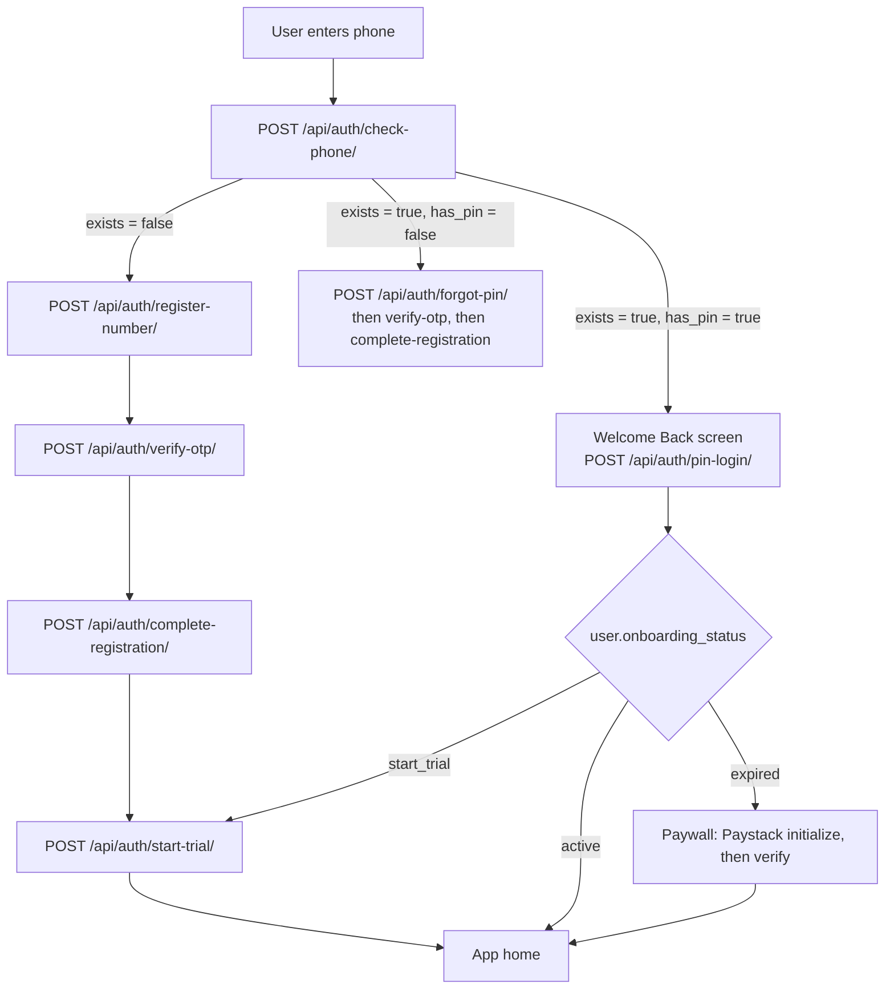

# Inventra Backend — Authentication Guide

How users sign up, log in, stay logged in, recover their PIN, and get past the trial/subscription paywall. Everything here is based on the current code in `accounts/`, `inventraBackend/settings.py` and `inventraBackend/urls.py`.

---

## Contents

1. [How it works (summary)](#1-how-it-works-summary)
2. [Core concepts](#2-core-concepts)
3. [User journeys (flows)](#3-user-journeys-flows)
4. [Endpoint reference](#4-endpoint-reference)
5. [Protecting the rest of the API (the subscription gate)](#5-protecting-the-rest-of-the-api-the-subscription-gate)
6. [Error format cheat sheet](#6-error-format-cheat-sheet)
7. [Django admin login](#7-django-admin-login)
8. [Configuration and environment variables](#8-configuration-and-environment-variables)
9. [Source file map](#9-source-file-map)
10. [Known security issues and gaps](#10-known-security-issues-and-gaps)

---

## 1. How it works (summary)

| Piece | Implementation |
|---|---|
| **Identity** | Phone number. `User.USERNAME_FIELD = 'phone'`, stored normalized as `+234XXXXXXXXXX`. |
| **Secret** | A **4-digit PIN**, stored as the Django password (hashed with `set_password`). |
| **Proof of phone ownership** | A **6-digit OTP** sent by SMS through Twilio, tracked with a `verification_id` (UUID). |
| **Session** | **JWT** from `djangorestframework-simplejwt`, sent as `Authorization: Bearer <access>`. |
| **Logout** | The refresh token is added to the simplejwt blacklist. |
| **Access gate** | Every `/api/products/...` business endpoint also needs an **active free trial or paid subscription** (`accounts.permissions.SubscriptionRequired`). |
| **Payments** | Paystack: ₦1,000/month (`100000` kobo). |
| **Admin panel** | `/admin/` uses **email + password** and is limited to staff accounts. |

There is **no username/password login endpoint** and **no `/api/token/` obtain endpoint**. Tokens are only issued by `verify-otp`, `pin-login` and `reset-pin`, and renewed by `/api/token/refresh/`.

---

## 2. Core concepts

### 2.1 Phone number normalization

Every endpoint that takes a phone number runs it through `normalize_ng_phone()` (`accounts/phone_utils.py`). All of these become `+2348012345678`:

| Input | Result |
|---|---|
| `+2348012345678` | `+2348012345678` |
| `2348012345678` | `+2348012345678` |
| `08012345678` | `+2348012345678` |
| `8012345678` (10 digits starting with 7/8/9) | `+2348012345678` |
| `0801 234 5678`, `0801-234-5678` | spaces and dashes are removed first |

User lookups use `phone_variants_for_lookup()`, which matches `+234…`, `234…` and `0…`, so older rows stored in a different format are still found.

> Any other format is **passed through unchanged** (for example `12345`). The serializer only rejects input that has no digits at all. The model column is `max_length=15`.

`mask_phone()` turns a number into `0801 *** 5678` for display (used by `check-phone`).

### 2.2 The PIN

- The PIN is the user's Django password: always exactly **4 digits**, checked by the serializers.
- An account created by `verify-otp` starts with an **unusable password** (no PIN). `has_pin` is `false` until `complete-registration` sets one.
- `has_pin` = `user.has_usable_password()`.

### 2.3 OTP sessions (`OTPVerification`)

| Field | Meaning |
|---|---|
| `verification_id` | UUID returned to the client; identifies this OTP session. |
| `phone` | Normalized phone the code was sent to. |
| `code` | 6-digit code (stored in plain text). |
| `is_used` | `True` once the session is finished. That happens on a **correct verify**, a **resend** (old session is killed), or when the **attempt limit** is reached. |
| `attempts` | Number of wrong guesses. At `OTP_MAX_ATTEMPTS` (5) the code is burned. |
| `expires_at` | `created + OTP_EXPIRY_MINUTES` (10 min). |

**Mock mode:** if `OTP_MOCK_MODE` is true (**the default when the env var is missing**), no SMS is sent and the OTP is **returned in the API response** as `"code"`. That's for development only. See [§10](#10-known-security-issues-and-gaps).

### 2.4 JWT tokens

| Setting | Value |
|---|---|
| Header | `Authorization: Bearer <access_token>` |
| Algorithm | HS256, signed with `SECRET_KEY` |
| Access token lifetime | **50 days** |
| Refresh token lifetime | **50 days** |
| Refresh rotation | On. Each refresh returns a **new** refresh token, and the old one is blacklisted. |
| Claim holding the user | `user_id` |

Token responses from the auth endpoints look like this:

```json
"tokens": {
  "access": "eyJhbGciOiJIUzI1NiIs...",
  "refresh": "eyJhbGciOiJIUzI1NiIs..."
}
```

### 2.5 The user profile object

Most auth endpoints return a `user` object (`UserProfileSerializer`):

```json
{
  "id": 12,
  "phone": "+2348012345678",
  "name": "Ada's Store",
  "business_name": "Ada Ventures",
  "business_type": "general_retail",
  "profile_image": "http://host/media/profile_pictures/ada.jpg",
  "has_pin": true,
  "onboarding_status": "active",
  "subscription_status": "trialing",
  "access_active": true,
  "is_paid": false
}
```

| Field | Values | Meaning |
|---|---|---|
| `onboarding_status` | `verify_number` | Phone verified but no PIN yet. Call `complete-registration`. |
| | `start_trial` | Has a PIN but never started the trial. Show the trial modal. |
| | `active` | Trial or paid subscription is valid. Full access. |
| | `expired` | Trial or subscription has ended. Show the paywall. |
| `subscription_status` | `none` / `trialing` / `active` / `expired` / `cancelled` | Billing state. `active` means **paid**. A lapsed trial or subscription reads `expired` right away. |
| `access_active` | bool | The user can use the product endpoints right now. |
| `is_paid` | bool | The user has a valid **paid** subscription (not a trial). |

> The mobile app should route on **`onboarding_status`**. It covers every case.

> For a brand-new account, `name` is set to the **phone number**. Onboarding doesn't collect a name, so use `PATCH /api/auth/profile/` to set a real one.

### 2.6 Business types

`business_type` must be one of:

| value | display |
|---|---|
| `general_retail` | General Retail |
| `food_drinks` | Food & Drinks |
| `pharmacy` | Pharmacy/Chemist |
| `fashion` | Fashion & Clothing |
| `wholesale` | Wholesale / Distributor |

### 2.7 Trial and subscription

- A `Subscription` row is **only** created when the user calls `start-trial` (or pays). No row means `onboarding_status = start_trial`.
- The trial length comes from the **App Settings** singleton in the admin panel (`AppSetting.trial_duration_minutes`). The default is **5 minutes** for testing. For a 3-month trial use `129600`.
- Each user gets **one** trial. Once the row exists, `start-trial` won't reset it.
- A payment sets `status='active'` and `current_period_end = now + 30 days`.

---

## 3. User journeys (flows)

### 3.1 App entry: which screen to show



> **Case: account exists but has no PIN** (the user verified the OTP and then quit before `complete-registration`). `register-number` returns **409** because the number exists, so use `forgot-pin` to get an OTP. `verify-otp` returns `needs_onboarding: true` along with tokens, and `complete-registration` then accepts the PIN because the account still has none.

### 3.2 New user registration

| # | Call | Auth | Send | Keep from the response |
|---|---|---|---|---|
| 1 | `GET /api/auth/business-types/` | none | none | list for the picker |
| 2 | `POST /api/auth/check-phone/` | none | `phone` | `exists` (should be `false`) |
| 3 | `POST /api/auth/register-number/` | none | `phone` | `verification_id` |
| 3b | `POST /api/auth/resend-otp/` (optional) | none | `verification_id` | **new** `verification_id` |
| 4 | `POST /api/auth/verify-otp/` | none | `verification_id`, `code` | `tokens.access`, `tokens.refresh` |
| 5 | `POST /api/auth/complete-registration/` | **Bearer** (token from step 4) | `business_type`, `pin`, `confirm_pin`, `business_name?` | `trial_offer` (modal text) |
| 6 | `POST /api/auth/start-trial/` | **Bearer** | none | `subscription` |

`complete-registration` does **not** issue new tokens. Keep using the tokens from step 4.

### 3.3 Returning user login

| # | Call | Auth | Send |
|---|---|---|---|
| 1 | `POST /api/auth/check-phone/` | none | `phone` (gets the name and avatar for "Welcome back") |
| 2 | `POST /api/auth/pin-login/` | none | `phone`, `pin` |

Then route on `user.onboarding_status`.

### 3.4 Forgot PIN

| # | Call | Auth | Send |
|---|---|---|---|
| 1 | `POST /api/auth/forgot-pin/` | none | `phone` (must belong to an existing account) |
| 2 | `POST /api/auth/verify-otp/` | none | `verification_id`, `code` |
| 3 | `POST /api/auth/reset-pin/` | none | `verification_id`, `pin`, `confirm_pin` (within **15 minutes** of step 1) |

Step 2 already returns tokens for the existing account. Step 3 returns a fresh set.

### 3.5 Staying logged in and logging out

- When the access token expires (401 `token_not_valid`), call `POST /api/token/refresh/` with the refresh token. **Store both** returned tokens, because the old refresh token is blacklisted.
- Logout: `POST /api/auth/logout/` with `refresh`, then delete both tokens on the device. (The access token keeps working until it expires. See [§10](#10-known-security-issues-and-gaps).)

---

## 4. Endpoint reference

**Base path:** `/api/auth/` (except token refresh, which is `/api/token/refresh/`).
**Request format:** JSON (`Content-Type: application/json`), except `profile`, which also accepts multipart for image upload.
**Auth column:**
- **Public**: no token needed.
- **Bearer**: needs `Authorization: Bearer <access>`. Trial or subscription is **not** required for any auth endpoint.

### Endpoint index

| Method | Route | Auth | Throttle | Purpose |
|---|---|---|---|---|
| GET | `/api/auth/business-types/` | Public | none | Business type options |
| POST | `/api/auth/check-phone/` | Public | none | Does an account exist? Does it have a PIN? |
| POST | `/api/auth/register-number/` | Public | `otp` 20/min | Send OTP to a **new** number |
| POST | `/api/auth/forgot-pin/` | Public | `otp` 20/min | Send OTP to an **existing** number |
| POST | `/api/auth/verify-otp/` | Public | none (5 guesses per code) | Check OTP, get tokens, create account if new |
| POST | `/api/auth/resend-otp/` | Public | `otp` 20/min | Replace an OTP session with a new code |
| POST | `/api/auth/complete-registration/` | Bearer | none | Set business type and PIN (first time only) |
| POST | `/api/auth/start-trial/` | Bearer | none | Start the one-time free trial |
| POST | `/api/auth/pin-login/` | Public | `pin_login` 10/min | Log in with phone and PIN |
| POST | `/api/auth/reset-pin/` | Public **or** Bearer | none | Set a new PIN |
| GET / PUT / PATCH | `/api/auth/profile/` | Bearer | none | Read or update the profile |
| POST | `/api/auth/change-pin/` | Bearer | none | Change PIN (needs current PIN) |
| POST | `/api/auth/logout/` | Public (refresh token in body) | none | Blacklist the refresh token |
| POST | `/api/token/refresh/` | Public (refresh token in body) | none | New access and refresh tokens |
| GET | `/api/auth/subscription/` | Bearer | none | Trial or subscription status |
| POST | `/api/auth/subscription/paystack/initialize/` | Bearer | none | Start a Paystack payment |
| POST | `/api/auth/subscription/paystack/verify/` | Bearer | none | Confirm a payment and activate the subscription |
| POST | `/api/auth/subscription/paystack/webhook/` | Paystack signature | none | Payment events from Paystack |

Throttles apply per client IP and only to **unauthenticated** requests (`AnonRateThrottle`). When a limit is hit the API returns **429** `{"detail": "Request was throttled. Expected available in N seconds."}`.

---

### 4.1 `GET /api/auth/business-types/`

The options for the "Choose Business Type" screen.

**Auth:** Public · **Body:** none

**200**
```json
[
  { "value": "general_retail", "display": "General Retail" },
  { "value": "food_drinks",    "display": "Food & Drinks" },
  { "value": "pharmacy",       "display": "Pharmacy/Chemist" },
  { "value": "fashion",        "display": "Fashion & Clothing" },
  { "value": "wholesale",      "display": "Wholesale / Distributor" }
]
```

---

### 4.2 `POST /api/auth/check-phone/`

Tells the app whether to show **Welcome Back** (PIN) or the **OTP** flow.

**Auth:** Public

| Field | Type | Required | Rules |
|---|---|---|---|
| `phone` | string | yes | max 20 chars, normalized (see §2.1) |

```json
{ "phone": "08012345678" }
```

**200 (account exists)**
```json
{
  "exists": true,
  "has_pin": true,
  "masked_phone": "0801 *** 5678",
  "name": "Ada's Store",
  "profile_image": "http://host/media/profile_pictures/ada.jpg"
}
```

**200 (no account)**
```json
{ "exists": false, "has_pin": false, "masked_phone": "0801 *** 5678" }
```

**400**: `{"phone": ["Invalid phone number."]}` or `{"phone": ["This field is required."]}`

---

### 4.3 `POST /api/auth/register-number/`

First step of registration. Sends an OTP, but **only to a number with no account**.

**Auth:** Public · **Throttle:** `otp` (20/min per IP)

| Field | Type | Required | Rules |
|---|---|---|---|
| `phone` | string | yes | max 20 chars, normalized |

```json
{ "phone": "08012345678" }
```

**200**
```json
{
  "verification_id": "3f1c2a8e-6b0d-4c1e-9d6a-2f7a1b9e0c44",
  "expires_in": 600,
  "message": "OTP sent to +2348012345678",
  "code": "482913"
}
```
> `code` is **only** included when `OTP_MOCK_MODE` is on.

| Status | Body | When |
|---|---|---|
| 400 | `{"phone": ["Invalid phone number."]}` | Bad input |
| 409 | `{"error": "An account with this phone number already exists. Please log in with your PIN.", "code": "account_exists"}` | Number already registered |
| 429 | throttle message | Too many requests |
| 503 | `{"error": "Unable to deliver OTP right now. Please try again shortly."}` | Twilio failed (the OTP row is deleted) |

---

### 4.4 `POST /api/auth/forgot-pin/`

First step of PIN recovery. Sends an OTP, but **only to a number that has an account**.

**Auth:** Public · **Throttle:** `otp` (20/min per IP)

| Field | Type | Required | Rules |
|---|---|---|---|
| `phone` | string | yes | max 20 chars, normalized |

**200**: same shape as `register-number`.

| Status | Body | When |
|---|---|---|
| 400 | `{"phone": [...]}` | Bad input |
| 404 | `{"error": "No account found for this phone number. Please register first.", "code": "account_not_found"}` | Unknown number |
| 429 / 503 | same as `register-number` | |

---

### 4.5 `POST /api/auth/verify-otp/`

Checks the OTP. **Creates the account** if the phone is new, otherwise signs into the existing account. Returns tokens either way.

**Auth:** Public · **Throttle:** none (each code allows at most 5 wrong guesses)

| Field | Type | Required | Rules |
|---|---|---|---|
| `verification_id` | UUID string | **yes** | from `register-number` / `forgot-pin` / `resend-otp` |
| `code` | string | yes | exactly 6 digits |

```json
{
  "verification_id": "3f1c2a8e-6b0d-4c1e-9d6a-2f7a1b9e0c44",
  "code": "482913"
}
```

> The Swagger description says "optional verification_id or phone", but the serializer **requires** `verification_id`. Phone isn't accepted here.

**200**
```json
{
  "user": { "...": "profile object (§2.5)" },
  "tokens": { "access": "…", "refresh": "…" },
  "is_new_user": true,
  "has_pin": false,
  "needs_onboarding": true,
  "verification_id": "3f1c2a8e-6b0d-4c1e-9d6a-2f7a1b9e0c44"
}
```

- `is_new_user`: `true` when this call created the account.
- `needs_onboarding`: `true` when the account is new or has no PIN. Go to `complete-registration`.
- New accounts have **no PIN** and **no trial**.

| Status | Body | When |
|---|---|---|
| 400 | `{"verification_id": [...]}` / `{"code": ["Code must be a 6-digit number."]}` | Bad input |
| 400 | `{"error": "No active verification code. Please request a new one."}` | Unknown ID, or already used/resent/burned |
| 400 | `{"error": "OTP has expired. Please request a new one."}` | Older than 10 min |
| 400 | `{"error": "Invalid OTP code. 4 attempt(s) remaining."}` | Wrong code |
| 400 | `{"error": "Too many incorrect attempts. Please request a new code."}` | 5th wrong code (the code is burned) |

---

### 4.6 `POST /api/auth/resend-otp/`

Ends the current OTP session and sends a new code to the same phone. **The response has a new `verification_id`. Use it from now on.**

**Auth:** Public · **Throttle:** `otp` (20/min per IP)

| Field | Type | Required |
|---|---|---|
| `verification_id` | UUID string | yes |

**200**
```json
{
  "verification_id": "a9e7…new-id…",
  "expires_in": 600,
  "message": "New OTP sent to +2348012345678",
  "code": "105377"
}
```
(`code` only in mock mode.)

| Status | Body | When |
|---|---|---|
| 400 | `{"error": "Invalid verification ID."}` | Unknown ID |
| 400 | `{"error": "This session has already been completed."}` | Session already used |
| 503 | delivery error | Twilio failed |

---

### 4.7 `POST /api/auth/complete-registration/`

The onboarding step that saves the business type and the PIN in one call. Only works **once**, while the account has no PIN.

**Auth:** **Bearer** (the access token from `verify-otp`)

| Field | Type | Required | Rules |
|---|---|---|---|
| `business_type` | string | yes | one of the values in §2.6 |
| `pin` | string | yes | exactly 4 digits |
| `confirm_pin` | string | yes | must equal `pin` |
| `business_name` | string | no | max 255, may be blank |

```json
{
  "business_type": "general_retail",
  "business_name": "Ada Ventures",
  "pin": "1234",
  "confirm_pin": "1234"
}
```

**200**
```json
{
  "success": true,
  "message": "Registration complete. Start your free trial to begin using Inventra.",
  "user": { "...": "profile, onboarding_status = start_trial" },
  "trial_required": true,
  "trial_offer": {
    "title": "Welcome to Inventra",
    "subtitle": "Start Your 5 Minutes Free Trial",
    "body": "Enjoy full access to every Inventra feature for the next 5 minutes. No payment is required today.",
    "note": "Your free trial starts immediately after activation.",
    "features": ["Full inventory management", "Sales tracking & reporting", "Debtor & finance tools", "No credit card required"],
    "cta": "Start Free Trial",
    "dismiss": "Not Now"
  }
}
```
(The trial wording follows the admin setting, for example "3 Months".)

| Status | Body | When |
|---|---|---|
| 400 | `{"business_type": ["\"x\" is not a valid choice."]}` / `{"pin": ["PIN must be exactly 4 digits."]}` / `{"confirm_pin": ["PINs do not match."]}` | Bad input |
| 401 | `{"detail": "Authentication credentials were not provided."}` | No token |
| 409 | `{"error": "An account with this phone number already exists. Please log in with your PIN.", "code": "account_exists"}` | Account already has a PIN |

No new tokens are issued.

---

### 4.8 `POST /api/auth/start-trial/`

The **Start Free Trial** button. Creates the `Subscription` row with `status='trialing'`.

**Auth:** **Bearer** · **Body:** none

**201**
```json
{
  "success": true,
  "message": "Your free trial is now active. Enjoy Inventra!",
  "subscription": { "...": "subscription object (see 4.15)" }
}
```

| Status | `code` | When |
|---|---|---|
| 400 | `onboarding_incomplete` | Account has no PIN yet |
| 409 | `trial_already_active` | Trial still running. Also returns `minutes_left`, `seconds_left`, `subscription`. |
| 409 | `already_subscribed` | Paid subscription is active |
| 409 | `trial_used` | Trial or subscription existed and has ended. Pay to continue. |

Example 409:
```json
{
  "success": false,
  "code": "trial_already_active",
  "message": "Your free trial has already started — 3 minute(s) and 12 second(s) left.",
  "minutes_left": 3,
  "seconds_left": 12,
  "subscription": { "...": "…" }
}
```

---

### 4.9 `POST /api/auth/pin-login/`

Login for returning users.

**Auth:** Public · **Throttle:** `pin_login` (10/min per IP)

| Field | Type | Required | Rules |
|---|---|---|---|
| `phone` | string | yes | max 20, normalized |
| `pin` | string | yes | exactly 4 digits |

```json
{ "phone": "08012345678", "pin": "1234" }
```

**200**
```json
{
  "user": { "...": "profile object (§2.5)" },
  "tokens": { "access": "…", "refresh": "…" }
}
```

| Status | Body | When |
|---|---|---|
| 400 | `{"pin": ["PIN must be exactly 4 digits."]}` | Bad input |
| 400 | `{"error": "Invalid PIN. Please check your credentials and try again."}` | Unknown phone **or** wrong PIN (same message for both) |
| 400 | `{"error": "This account has been deactivated."}` | `is_active = False` |
| 429 | throttle message | More than 10 attempts/min from the IP |

Login works even when the trial has expired. The app then reads `onboarding_status` and shows the paywall.

---

### 4.10 `POST /api/auth/reset-pin/`

Sets a new PIN. There are two ways to prove identity:

1. **Forgot-PIN flow (no token):** send the `verification_id` of an OTP session finished within the last **15 minutes** (measured from when the OTP was **created**).
2. **Logged in:** send a Bearer token and no `verification_id` is needed. **The current PIN is not checked** (unlike `change-pin`).

**Auth:** Public or Bearer

| Field | Type | Required | Rules |
|---|---|---|---|
| `verification_id` | UUID string | only when no Bearer token | from `forgot-pin`, after `verify-otp` |
| `pin` | string | yes | exactly 4 digits |
| `confirm_pin` | string | yes | must equal `pin` |

```json
{
  "verification_id": "3f1c2a8e-6b0d-4c1e-9d6a-2f7a1b9e0c44",
  "pin": "5678",
  "confirm_pin": "5678"
}
```

**200**
```json
{
  "success": true,
  "message": "PIN reset successfully.",
  "user": { "...": "profile" },
  "tokens": { "access": "…", "refresh": "…" }
}
```

| Status | Body | When |
|---|---|---|
| 400 | serializer errors | Bad PIN or mismatch |
| 400 | `{"error": "Invalid or expired OTP session. Please verify your phone number first."}` | No finished session with that ID in the last 15 min |
| 400 | `{"error": "Authentication or valid verification_id is required to reset PIN."}` | Neither a token nor an ID |
| 404 | `{"error": "User account not found."}` | Session phone has no account |

> ⚠️ See [§10, issue 1](#10-known-security-issues-and-gaps). Right now this endpoint can be used without knowing the OTP.

---

### 4.11 `GET | PUT | PATCH /api/auth/profile/`

**Auth:** **Bearer** · **Content types:** JSON, `multipart/form-data`, form-encoded

**GET 200**: profile object (§2.5).

**PUT / PATCH**: both are treated as partial updates, so send only what you want to change.

| Field | Type | Writable | Notes |
|---|---|---|---|
| `name` | string (max 255) | ✅ | |
| `business_name` | string (max 255) | ✅ | |
| `business_type` | choice (§2.6) | ✅ | |
| `profile_image` | file | ✅ | send as `multipart/form-data`, saved under `media/profile_pictures/` |
| `id`, `phone`, `has_pin`, `onboarding_status`, `subscription_status`, `access_active`, `is_paid` | | ❌ read-only | ignored if sent |

`email` isn't part of this serializer, so it can't be changed here (only through Paystack initialize, §4.16).

```bash
curl -X PATCH http://localhost:8000/api/auth/profile/ \
  -H "Authorization: Bearer <access>" \
  -F "name=Ada's Store" \
  -F "profile_image=@avatar.jpg"
```

**200**: updated profile · **400**: field errors · **401**: no or invalid token

---

### 4.12 `POST /api/auth/change-pin/`

Change the PIN while logged in. Requires the **current PIN**.

**Auth:** **Bearer**

| Field | Type | Required | Rules |
|---|---|---|---|
| `current_pin` | string | yes | 4 digits |
| `pin` | string | yes | 4 digits |
| `confirm_pin` | string | yes | must equal `pin` |

```json
{ "current_pin": "1234", "pin": "5678", "confirm_pin": "5678" }
```

**200**
```json
{ "success": true, "message": "PIN changed successfully.", "user": { "...": "profile" } }
```

| Status | Body |
|---|---|
| 400 | `{"current_pin": "Current PIN is incorrect."}` (a plain string, not a list) |
| 400 | `{"confirm_pin": ["PINs do not match."]}` / `{"pin": ["PIN must be exactly 4 digits."]}` |

No new tokens are issued, and existing tokens stay valid.

---

### 4.13 `POST /api/auth/logout/`

simplejwt `TokenBlacklistView`. Blacklists the refresh token so it can't be used again.

**Auth:** Public (the refresh token in the body is the credential)

| Field | Type | Required |
|---|---|---|
| `refresh` | string | yes |

```json
{ "refresh": "eyJhbGciOi..." }
```

**200**: `{}`

| Status | Body | When |
|---|---|---|
| 400 | `{"refresh": ["This field is required."]}` | Missing |
| 401 | `{"detail": "Token is blacklisted", "code": "token_not_valid"}` | Already logged out or rotated |
| 401 | `{"detail": "Token is invalid", "code": "token_not_valid"}` (wording varies) | Malformed or expired token |

---

### 4.14 `POST /api/token/refresh/`

Exchanges a refresh token for a new access token **and a new refresh token** (rotation is on). The refresh token you sent is blacklisted.

**Auth:** Public

| Field | Type | Required |
|---|---|---|
| `refresh` | string | yes |

**200**
```json
{ "access": "eyJ…new…", "refresh": "eyJ…new…" }
```

| Status | When |
|---|---|
| 401 `token_not_valid` | Expired, malformed or blacklisted refresh token |
| 401 `no_active_account` | User was deactivated |

---

### 4.15 `GET /api/auth/subscription/`

**Auth:** **Bearer**

**200 (trial never started)**
```json
{
  "status": "none",
  "access_active": false,
  "trial_started": false,
  "trial_offer": { "...": "same object as in complete-registration" }
}
```

**200 (subscription row exists)**
```json
{
  "status": "trialing",
  "access_active": true,
  "seconds_remaining": 214,
  "trial_started_at": "2026-09-11T10:00:00Z",
  "current_period_start": "2026-09-11T10:00:00Z",
  "current_period_end": "2026-09-11T10:05:00Z",
  "amount_kobo": 100000,
  "amount_naira": 1000.0,
  "interval": "monthly",
  "last_payment_reference": null,
  "trial_started": true
}
```
`status` is one of `trialing`, `active` (paid), `expired`, `cancelled`. A lapsed row is changed to `expired` when this endpoint reads it.

---

### 4.16 `POST /api/auth/subscription/paystack/initialize/`

Starts a ₦1,000 Paystack checkout.

**Auth:** **Bearer**

| Field | Type | Required | Notes |
|---|---|---|---|
| `email` | string | only if the user has no email saved | If it differs from the saved email, **the user's email is overwritten** |
| `callback_url` | string | no | Defaults to `PAYSTACK_CALLBACK_URL` |

```json
{ "email": "ada@example.com" }
```

**200**
```json
{
  "reference": "inventra-12-1757584800",
  "amount_naira": 1000,
  "interval": "monthly",
  "authorization_url": "https://checkout.paystack.com/abc123",
  "access_code": "abc123"
}
```
Open `authorization_url` in a web view or browser, then call **verify** with `reference`.

| Status | When |
|---|---|
| 400 `{"email": "An email address is required for Paystack payment."}` | No email |
| 503 `{"error": "Paystack is not configured on the server."}` / `"...temporarily unavailable..."` | Missing secret key or network failure |

---

### 4.17 `POST /api/auth/subscription/paystack/verify/`

Checks the payment with Paystack. On success, sets `status='active'` and extends the period by 30 days.

**Auth:** **Bearer**

| Field | Type | Required |
|---|---|---|
| `reference` | string | yes |

**200**
```json
{
  "success": true,
  "message": "Payment confirmed. Your monthly subscription is active.",
  "subscription": { "...": "subscription object" }
}
```

| Status | Body |
|---|---|
| 400 | `{"reference": "Payment reference is required."}` |
| 400 | `{"error": "Payment could not be verified. Please try again."}` |
| 400 | `{"error": "Payment amount or currency is invalid."}` (must be exactly 100000 kobo, NGN) |

---

### 4.18 `POST /api/auth/subscription/paystack/webhook/`

Called by **Paystack**, not the app.

**Auth:** header `x-paystack-signature` must equal `HMAC-SHA512(raw_body, PAYSTACK_SECRET_KEY)` in hex.

Only `event = "charge.success"` does anything. It checks `amount == 100000` and `currency == "NGN"`, then activates the subscription for `data.metadata.user_id` (set by `initialize`).

| Status | Body |
|---|---|
| 200 | `{"received": true}` |
| 400 | `{"error": "Invalid subscription payment."}` |
| 401 | `{"error": "Invalid webhook signature."}` |

---

## 5. Protecting the rest of the API (the subscription gate)

`products/views.py` and `products/finance/views.py` do:

```python
from accounts.permissions import SubscriptionRequired as IsAuthenticated
```

So every endpoint there that uses `IsAuthenticated` actually needs **a valid JWT and an active trial or paid subscription**.

| Route(s) | Requirement |
|---|---|
| `/api/products/categories/`, `/api/products/suppliers/` (read-only) | **Public** (`AllowAny`) |
| `/api/products/quantity-types/` | **Public** (no authentication at all) |
| `/api/docs/`, `/api/redoc/`, `/api/schema/` | Public |
| `/api/products/items/`, `/global-products/`, `/user-inventory/`, `/sales/`, `/restocks/`, `/notifications/` | Bearer **+ active subscription** |
| `/api/products/dashboard/overview/`, `/analytics/*`, `/finance/*` | Bearer **+ active subscription** |
| All `/api/auth/*` Bearer endpoints | Bearer only, **no** subscription needed |

**Responses from the gate:**

| Status | Body | Show |
|---|---|---|
| 401 | `{"detail": "Authentication credentials were not provided."}` | Login |
| 401 | `{"detail": "Given token not valid for any token type", "code": "token_not_valid", "messages": [...]}` | Refresh the token, or log in |
| 403 | `{"detail": "Start your free trial to begin using Inventra.", "code": "trial_required"}` | Trial modal (`start-trial`) |
| 403 | `{"detail": "Your free trial or subscription has ended. Please pay your monthly subscription of N1,000 to continue using Inventra.", "code": "subscription_expired"}` | Paywall |

**Data scoping:** views filter by `request.user` (`created_by`, `sold_by`, `restocked_by`, `user`), so each user only sees their own data. The exception is `ProductViewSet`, where **staff** users (`is_staff`) see every product.

---

## 6. Error format cheat sheet

The API uses three error shapes, so the client should handle all of them:

| Source | Shape | Example |
|---|---|---|
| Serializer validation | `{ "<field>": ["message", ...] }` | `{"pin": ["PIN must be exactly 4 digits."]}` |
| View logic | `{ "error": "message", "code"?: "machine_code" }` | `{"error": "...", "code": "account_exists"}` |
| DRF / simplejwt / gate | `{ "detail": "message", "code"?: "..." }` | `{"detail": "...", "code": "trial_required"}` |

Machine-readable `code` values: `account_exists`, `account_not_found`, `onboarding_incomplete`, `trial_already_active`, `already_subscribed`, `trial_used`, `trial_required`, `subscription_expired`, `token_not_valid`, `no_active_account`.

> In mock mode, `code` in a **200** OTP response is the **OTP itself**, not an error code. Check the HTTP status before reading `code`.

---

## 7. Django admin login

- URL: `/admin/` (Jazzmin theme).
- Uses `EmailAdminAuthenticationForm` (`accounts/forms.py`): **email + password**, and the user must have `is_staff = True`.
- Create an admin with `.venv/Scripts/python.exe manage.py createsuperuser`. It asks for phone, name, **email** (required) and password.
- The admin panel holds **App Settings** (trial length), **Subscriptions** and **Users**.
- `accounts.backends.PhoneOrEmailBackend` (phone variants or email + password) is set in `AUTHENTICATION_BACKENDS`, but the API views don't use it. They call `check_password` directly.

---

## 8. Configuration and environment variables

Loaded from `.env` by `python-dotenv` in `settings.py`.

| Variable / setting | Default | Purpose |
|---|---|---|
| `SECRET_KEY` | hard-coded `django-insecure-…` fallback | Signs JWTs. **Must** be set in production. |
| `DEBUG` | `True` | |
| `OTP_MOCK_MODE` | **`True`** | When true, no SMS is sent and the OTP is returned in responses. **Set to `False` in production.** |
| `OTP_EXPIRY_MINUTES` | `10` | (settings.py) |
| `OTP_MAX_ATTEMPTS` | `5` | (settings.py) |
| `TWILIO_ACCOUNT_SID`, `TWILIO_AUTH_TOKEN`, `TWILIO_SMS_FROM` | empty | SMS delivery. All three are needed when mock mode is off. |
| `TWILIO_VERIFY_SERVICE_SID`, `META_WHATSAPP_PHONE_NUMBER_ID` | empty | Defined but **not used** anywhere |
| `PAYSTACK_SECRET_KEY` | empty | Paystack API and webhook signature |
| `PAYSTACK_PUBLIC_KEY` | empty | Not used by the backend |
| `PAYSTACK_PLAN_CODE` | empty | Optional Paystack plan attached to the payment |
| `PAYSTACK_CALLBACK_URL` | empty | Default redirect after checkout |
| `DEFAULT_THROTTLE_RATES` | `otp: 20/min`, `pin_login: 10/min` | (settings.py) |
| `SIMPLE_JWT` lifetimes | 50 days / 50 days | (settings.py) |
| `CORS_ALLOW_ALL_ORIGINS` | `True` | |
| App Settings → `trial_duration_minutes` | `5` | Set in the admin panel, not env |

---

## 9. Source file map

| File | What's in it |
|---|---|
| `inventraBackend/urls.py` | Mounts `/api/auth/` and `/api/token/refresh/` |
| `inventraBackend/settings.py` | DRF, JWT, throttles, OTP, Twilio, Paystack settings |
| `accounts/urls.py` | All auth routes |
| `accounts/views.py` | All auth views, OTP issuing, Paystack helpers, trial offer text |
| `accounts/serializers.py` | Request validation and the profile/subscription output |
| `accounts/models.py` | `User`, `Subscription`, `AppSetting`, `OTPVerification`, `BUSINESS_TYPE_CHOICES` |
| `accounts/permissions.py` | `SubscriptionRequired` gate and `TrialRequired` 403 |
| `accounts/throttles.py` | `OTPRequestThrottle`, `PinLoginThrottle` |
| `accounts/phone_utils.py` | Phone normalization, lookup variants, masking |
| `accounts/otp_delivery.py` | Twilio SMS sending |
| `accounts/backends.py` | Phone-or-email auth backend |
| `accounts/forms.py` | Email-based admin login form |
| `accounts/tests.py` | Flow tests (OTP, onboarding, trial, reset, attempt cap) |

---

## 10. Known security issues and gaps

Found while writing this doc. Issues 1 and 2 were **reproduced** against a throwaway test database. The rest come from reading the code.

### 1. 🔴 CRITICAL: anyone can reset any user's PIN without the OTP (account takeover)

`reset_pin` accepts any OTP session where `is_used=True` and that was created in the last 15 minutes. But `is_used` is also set to `True` when a code is **resent** (the old session) or **burned after 5 wrong guesses**, not only when it's verified correctly.

The attack, using only the victim's phone number:
1. `POST /forgot-pin/ {"phone": "<victim>"}` returns `verification_id`.
2. `POST /resend-otp/ {"verification_id": ...}` marks that ID as used. (Or send 5 wrong codes to `/verify-otp/`.)
3. `POST /reset-pin/ {"verification_id": <from step 1>, "pin": "9999", "confirm_pin": "9999"}` returns **200 with the victim's tokens**, and their PIN is now changed.

Both variants were confirmed: status 200, tokens returned, and the victim's PIN changed.

**Fix:** add a `verified_at` (or `is_verified`) field to `OTPVerification` that is set **only** in the success branch of `verify_otp`. Have `reset_pin` require it. Mark the session as consumed after a reset so it can't be used twice, and measure the 15-minute window from `verified_at`.

### 2. 🟠 HIGH: logout and PIN changes don't end existing sessions

- Logout only blacklists the **refresh** token. The **access** token keeps working for up to **50 days**. (Confirmed: `GET /profile/` returned 200 with the old access token after logout.)
- `change-pin` and `reset-pin` don't revoke existing tokens either, so a stolen token still works after the owner changes their PIN.

**Fix:** shorten `ACCESS_TOKEN_LIFETIME` (for example 15–60 min, and let the app refresh). To revoke immediately, add a per-user `token_version` claim, or blacklist all of the user's outstanding tokens when the PIN changes.

### 3. 🟠 HIGH: unsafe defaults if `.env` is incomplete

`OTP_MOCK_MODE` defaults to **True**. If production is missing that variable, the OTP comes back in the API response. Anyone could then call `forgot-pin` for any number and `verify-otp` with the returned code, and get that user's tokens. `DEBUG` defaults to `True`, and `SECRET_KEY` has a public fallback (anyone who knows it can forge JWTs).

**Fix:** default these to the safe values (`OTP_MOCK_MODE=False`, `DEBUG=False`), and fail at startup if `SECRET_KEY` isn't set.

### 4. 🟡 MEDIUM: `reset-pin` with a Bearer token skips the current-PIN check

This undoes the protection in `change-pin`. Anyone holding an access token (a stolen phone, an unlocked device) can set a new PIN without knowing the old one.

**Fix:** make `reset-pin` accept only the verified-OTP path, and leave logged-in PIN changes to `change-pin`.

### 5. 🟡 MEDIUM: Paystack verification can be reused

- `verify` doesn't check that `metadata.user_id` in the Paystack response matches `request.user`.
- The same `reference` can be verified again later. Each call sets `current_period_end = now + 30 days`, so one payment can be stretched indefinitely. The `unique` constraint on `last_payment_reference` doesn't stop this, because the same row is updated each time.
- Webhook replays re-activate the subscription in the same way.

**Fix:** store processed references in their own table (unique), reject any reference already seen, and check `metadata.user_id == request.user.id`.

### 6. 🟡 MEDIUM: brute-force and enumeration

- `pin-login` only limits **per IP** (10/min). There's no lockout per account, and a 4-digit PIN has only 10,000 combinations, so an attacker with many IPs can try them all. Add a failed-attempt counter per phone with a temporary lockout.
- `check-phone` has **no throttle**. It reveals whether a number is registered, plus the user's **name and profile photo**. Add the `otp` throttle, or return less.
- `verify-otp` has no IP throttle. It's capped at 5 guesses per code, but new codes can be requested 20 times a minute.

### 7. 🟢 LOW: smaller issues

- `pin-login` checks the PIN **before** `is_active`, so the "deactivated" message confirms the PIN was correct.
- `paystack/initialize` overwrites `user.email` with whatever is sent. Because `email` is unique, an email already used by another account causes an unhandled **500** error.
- `normalize_ng_phone` lets unknown formats through unchanged, so junk like `12345` is accepted as a phone.
- The OTP is generated with `random.choices`. Use `secrets.choice` for security codes. Codes are also stored in plain text.
- `CORS_ALLOW_ALL_ORIGINS = True`. Lower risk here because auth uses a header, not cookies, but it should be narrowed for production.
- `ProductViewSet` defines `destroy()` **twice**. The second one (soft delete) overrides the first, so the "only staff can delete master products" check never runs.
- Swagger says `verify-otp` accepts `phone` as an alternative to `verification_id`. It doesn't.
